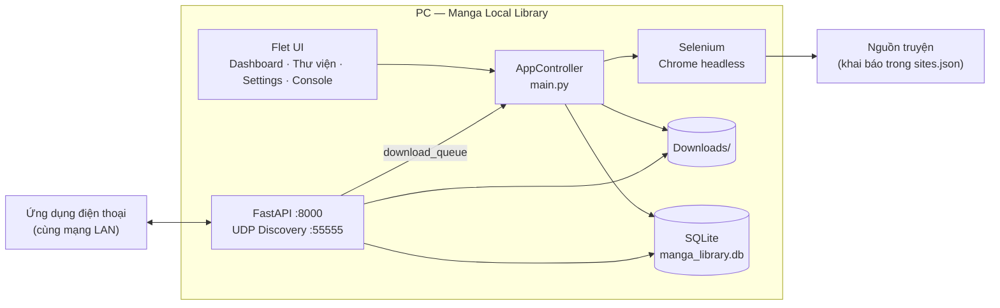
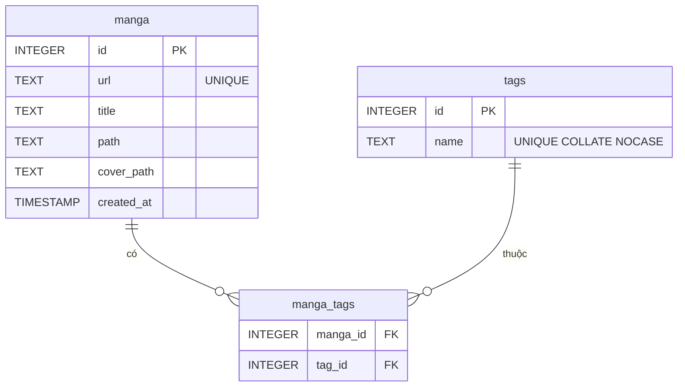

<div align="center">

# Manga Local Library

**Ứng dụng desktop tải truyện tranh, quản lý thư viện cục bộ và phát nội dung sang điện thoại trong cùng mạng LAN.**


</div>

---

## Mục lục

- [Tổng quan](#tổng-quan)
- [Tính năng](#tính-năng)
- [Kiến trúc](#kiến-trúc)
- [Luồng tải truyện](#luồng-tải-truyện)
- [Cấu trúc dự án](#cấu-trúc-dự-án)
- [Yêu cầu hệ thống](#yêu-cầu-hệ-thống)
- [Cài đặt](#cài-đặt)
- [Cấu hình](#cấu-hình)
- [Tham chiếu API](#tham-chiếu-api)
- [Cơ sở dữ liệu](#cơ-sở-dữ-liệu)
- [Đóng gói ứng dụng](#đóng-gói-ứng-dụng)
- [Xử lý sự cố](#xử-lý-sự-cố)
- [Ghi chú kỹ thuật](#ghi-chú-kỹ-thuật)
- [Miễn trừ trách nhiệm](#miễn-trừ-trách-nhiệm)

---

## Tổng quan

Manga Local Library là ứng dụng desktop viết bằng Python, đảm nhiệm ba vai trò trong cùng một tiến trình:

| Vai trò | Thành phần | Mô tả |
| --- | --- | --- |
| **Downloader** | Selenium + Chrome headless | Phân tích trang truyện, bóc tách danh sách chương và tải toàn bộ ảnh về máy. |
| **Local Library** | SQLite + Flet Reader | Lập chỉ mục truyện đã tải kèm thẻ (tag), tìm kiếm nâng cao và đọc truyện ngay trong app. |
| **LAN Server** | FastAPI + UDP Discovery | Mở REST API để ứng dụng điện thoại trong cùng mạng tự tìm thấy máy tính, duyệt thư viện và gửi lệnh tải về PC. |

Toàn bộ dữ liệu nằm trên máy người dùng: không có máy chủ trung gian, không đồng bộ ra ngoài.

---

## Tính năng

**Tải truyện**

- Dán link truyện và tải toàn bộ chương với một lần bấm.
- Tự nhận diện tên truyện, thể loại (tag) và ảnh bìa; nếu không lấy được bìa gốc, hệ thống tạo bìa dự phòng từ trang đầu tiên.
- Chọn định dạng ảnh đầu ra: `PNG`, `JPEG` (chất lượng 90) hoặc giữ nguyên file gốc.
- Hạn chế bị phát hiện tự động hoá ở mức cơ bản: tuỳ biến User-Agent, tắt cờ `AutomationControlled`.

**Thư viện & Trình đọc**

- Thư viện dạng lưới với ảnh bìa và tìm kiếm theo tên.
- Bộ lọc tag ba trạng thái: *bắt buộc có* (INCLUDE) / *loại trừ* (EXCLUDE) / *bỏ qua*.
- Trình đọc tích hợp: cuộn liên tục, điều hướng chương, thanh zoom (0.2x – 1.0x), nền sáng/tối, ẩn/hiện giao diện.
- Tự dò lại đường dẫn khi thư mục truyện bị di chuyển (`smart_path_resolve`).

**Kết nối điện thoại**

- Ứng dụng điện thoại tự tìm máy tính qua UDP broadcast, không cần nhập IP thủ công.
- Điện thoại duyệt thư viện và đọc truyện trực tiếp từ ổ đĩa PC qua HTTP.
- Điện thoại gửi link về PC; lệnh được xếp hàng đợi (`queue.Queue`) và xử lý lần lượt để tránh xung đột Selenium.

**Hệ thống**

- Thu nhỏ xuống System Tray thay vì thoát; menu tray để mở lại hoặc kết thúc ứng dụng.
- Tuỳ chọn tự khởi động cùng Windows ở chế độ ẩn (tham số `--hidden`, ghi qua Registry `HKCU\...\Run`).
- Tab **Console** hiển thị log hệ thống và log server theo thời gian thực (`stdout`/`stderr` được chuyển hướng vào UI).
- Quản lý nguồn truyện ngay trong app: sửa link khi website đổi domain hoặc thêm nguồn mới.

---

## Kiến trúc



Ứng dụng chạy một tiến trình với nhiều luồng:

| Luồng | Nhiệm vụ |
| --- | --- |
| Luồng chính | Vòng lặp giao diện Flet. |
| `uvicorn` | Phục vụ FastAPI trên `0.0.0.0:8000`. |
| `run_discovery_listener` | Lắng nghe UDP broadcast trên cổng `55555`. |
| `monitor_remote_commands` | Lấy lệnh từ `download_queue` và chạy tải tuần tự. |
| `pystray` | Biểu tượng System Tray. |
| Luồng tải | Mỗi lần bấm "Khởi động tải xuống" sinh một luồng nền riêng. |

---

## Luồng tải truyện

1. Chuẩn hoá link và khởi tạo Chrome headless (`page_load_strategy = eager`).
2. Mở trang truyện, lấy tên từ thẻ `h1` (dự phòng: `document.title`), làm sạch thành tên thư mục an toàn.
3. Bóc tách tag từ khối "Thể loại"; không có tag thì gán `Chưa phân loại`.
4. Tải ảnh bìa từ `style="background-image: url(...)"` hoặc thẻ `img` trong khối thông tin truyện.
5. Dò nút "Bắt đầu đọc" để chuyển vào trang đọc.
6. Lấy danh sách chương từ dropdown `#chapter-selector`, loại bỏ URL trùng và sắp xếp theo thứ tự tăng dần.
7. Với từng chương: khoanh vùng container ảnh (`#chapter-content`, `.reading-content`, `.page-chapter`, …), lọc ảnh rác (logo, icon, avatar, banner, loader), tải ảnh bằng `requests.Session` kế thừa cookie từ Selenium, rồi lưu qua Pillow.
8. Ghi bản ghi truyện kèm tag vào SQLite và làm mới thư viện trên UI.

Kết quả trên ổ đĩa:

```
Downloads/
└── Ten_Truyen/
    ├── cover.jpg
    ├── Chuong 1/
    │   ├── Trang_000.png
    │   └── Trang_001.png
    └── Chuong 2/
        └── ...
```

---

## Cấu trúc dự án

```
MangaDownloader_Project/
├── main.py                     # Điểm khởi chạy: AppController, Selenium, uvicorn, System Tray
├── server_pc.py                # FastAPI + UDP Discovery + hàng đợi lệnh từ điện thoại
├── gui/
│   └── app_layout.py           # MangaApp: giao diện Flet, thư viện, trình đọc, settings
├── core/
│   ├── database.py             # DatabaseManager: schema, lưu truyện, tìm kiếm nâng cao
│   ├── domain_manager.py       # Đọc/ghi sites.json, tự cập nhật khi nguồn đổi domain
│   └── image_manager.py        # Chuyển đổi và lưu ảnh (PNG/JPEG/WEBP/gốc)
├── connectors/
│   ├── base.py                 # BaseConnector: giao diện chuẩn cho mỗi nguồn truyện
│   └── mangaconnect.py         # Connector dựa trên DrissionPage (xem Ghi chú kỹ thuật)
├── utils/
│   ├── logger.py               # Ghi log ra logs/log_YYYY-MM-DD.txt và crash report
│   ├── startup_helper.py       # Bật/tắt tự khởi động qua Windows Registry
│   ├── system_helper.py        # get_app_dir(): đường dẫn gốc khi chạy .py và .exe
│   └── text_helper.py          # clean_filename(): tên file an toàn cho Windows
├── assets/                     # Ảnh nền cho trình đọc
├── sites.example.json          # Mẫu khai báo nguồn truyện (không chứa địa chỉ thật)
├── config.json                 # Thư mục lưu truyện
├── manga_library.db            # SQLite (tự tạo)
├── requirements.txt
└── *.spec                      # Cấu hình PyInstaller của các bản build
```

---

## Yêu cầu hệ thống

| Thành phần | Yêu cầu |
| --- | --- |
| Hệ điều hành | Windows 10/11 (System Tray và tự khởi động phụ thuộc Windows API) |
| Python | 3.11 trở lên (dự án đang phát triển trên 3.14) |
| Trình duyệt | Google Chrome — ChromeDriver được `webdriver-manager` tải tự động |
| Mạng | PC và điện thoại cùng một mạng LAN; mở cổng TCP `8000` và UDP `55555` |

---

## Cài đặt

```bat
:: 1. Tạo môi trường ảo
python -m venv venv
venv\Scripts\activate

:: 2. Cài thư viện
pip install -r requirements.txt

:: 3. Cài thêm thư viện System Tray (chưa có trong requirements.txt)
pip install pystray

:: 4. Chuẩn bị danh sách nguồn truyện
copy sites.example.json sites.json

:: 5. Chạy ứng dụng
python main.py
```

Sau khi mở app, vào tab **Settings → Quản lý nguồn truyện** để thay URL mẫu bằng địa chỉ thật, hoặc thêm nguồn mới.

> Nếu `sites.json` chưa tồn tại, ứng dụng tự sinh file này từ `sites.example.json` ở lần chạy đầu tiên.

---

## Cấu hình

### `config.json`

```json
{
    "download_path": "D:\\MangaDownloader_Project\\Downloads"
}
```

| Khoá | Mặc định | Ý nghĩa |
| --- | --- | --- |
| `download_path` | `Downloads` | Thư mục lưu truyện. Thay đổi được trong tab Settings. |

### `sites.json`

Danh sách nguồn truyện, mỗi khoá là một ID nguồn:

```json
{
    "site_chinh": {
        "name": "Nguồn chính (Tên hiển thị)",
        "url": "https://example.com",
        "connector": "mangaconnect"
    }
}
```

| Trường | Ý nghĩa |
| --- | --- |
| `name` | Tên hiển thị trong giao diện. |
| `url` | Link trang chủ. `check_and_update_domain()` tự ghi lại URL mới nếu nguồn redirect sang domain khác. |
| `connector` | Bộ xử lý dành cho nguồn đó. |

> **Lưu ý:** `sites.json` là file cấu hình cục bộ và đã được `.gitignore` loại trừ, nên địa chỉ thật không bị đưa lên repository. Chỉ `sites.example.json` được commit.

---

## Tham chiếu API

Server lắng nghe tại `http://<IP-LAN-của-PC>:8000`.

| Method | Endpoint | Mô tả | Phản hồi |
| --- | --- | --- | --- |
| `GET` | `/library` | Danh sách truyện kèm ảnh bìa và tag, mới nhất trước. | `[{ "title", "cover", "tags": [] }]` |
| `GET` | `/manga/{manga_name}` | Danh sách chương và URL ảnh của một truyện. | `[{ "name", "images": [] }]` |
| `POST` | `/download` | Đẩy link vào hàng đợi để PC tải. Body: `{ "url": "..." }` | `{ "status": "ok", "message", "url" }` |
| `GET` | `/images/...` | Phục vụ tĩnh toàn bộ thư mục `Downloads/`. | Nội dung ảnh |

### UDP Discovery

| Thuộc tính | Giá trị |
| --- | --- |
| Cổng | `55555` (UDP broadcast) |
| Điện thoại gửi | `DISCOVER_MANGA_SERVER` |
| PC trả lời | `I_AM_MANGA_SERVER` |

Ví dụ gửi lệnh tải từ dòng lệnh:

```bash
curl -X POST http://192.168.1.10:8000/download \
     -H "Content-Type: application/json" \
     -d '{"url": "https://example.com/truyen/abc"}'
```

---

## Cơ sở dữ liệu

SQLite tại `manga_library.db`, nằm cùng thư mục với `main.py` (hoặc cùng thư mục `.exe` khi đã đóng gói).



- `manga.url` là `UNIQUE`: tải lại cùng một truyện sẽ cập nhật bản ghi cũ thay vì tạo bản ghi trùng.
- `tags.name` dùng `COLLATE NOCASE`, nên "Action" và "action" được xem là cùng một tag.
- `search_advanced()` dựng truy vấn động: `LIKE` cho tên truyện, `IN` cho tag bắt buộc (logic AND) và `NOT IN` cho tag loại trừ.

---

## Đóng gói ứng dụng

Dùng `flet pack` thay vì gọi PyInstaller trực tiếp, để Flet nhúng đúng icon vào tiến trình `flet.exe` chạy ngầm trên Windows:

```bat
flet pack main.py ^
  --icon "app_icon.ico" ^
  --name "MangaLocalLibrary_v2.5.3" ^
  --onedir ^
  --add-data "assets;assets" ^
  --hidden-import flet --hidden-import gui --hidden-import core --hidden-import utils ^
  --hidden-import uvicorn.logging --hidden-import uvicorn.loops --hidden-import uvicorn.loops.auto ^
  --hidden-import uvicorn.protocols --hidden-import uvicorn.protocols.http ^
  --hidden-import uvicorn.protocols.http.auto ^
  --hidden-import uvicorn.lifespan --hidden-import uvicorn.lifespan.on ^
  --hidden-import selenium --hidden-import webdriver_manager --hidden-import requests ^
  --hidden-import pystray --hidden-import PIL -y
```

Ba điểm bắt buộc khi build:

1. `--icon` phải là file `.ico` để Windows hiển thị đúng icon trên Taskbar.
2. `--add-data "assets;assets"` để trình đọc load được ảnh nền và logo.
3. `--hidden-import pystray --hidden-import PIL` để System Tray hoạt động trong bản `.exe`.

Nên dùng `--onedir`: dữ liệu (`Downloads/`, `manga_library.db`, `config.json`, `sites.json`) được ghi cạnh file `.exe` nhờ `get_app_dir()`, thay vì nằm trong thư mục tạm `_internal`.

---

## Xử lý sự cố

| Hiện tượng | Nguyên nhân thường gặp | Cách xử lý |
| --- | --- | --- |
| Điện thoại không tìm thấy PC | Firewall chặn UDP `55555` / TCP `8000`, hoặc hai thiết bị khác mạng | Mở cổng cho ứng dụng trong Windows Defender Firewall; tắt "AP Isolation" trên router |
| Điện thoại báo đã gửi nhưng Console trống | PC có nhiều card mạng ảo (WSL, Docker, VirtualBox) khiến điện thoại gửi POST sai subnet | Tắt adapter ảo, hoặc nhập trực tiếp IP LAN đúng của PC trên app điện thoại |
| `❌ Lỗi kết nối! Kiểm tra lại Link hoặc Mạng` | Link sai, nguồn đã đổi domain, hoặc nguồn chặn truy cập | Cập nhật URL trong **Settings → Quản lý nguồn truyện** |
| `❌ Không tìm thấy chương nào!` | Nguồn đổi cấu trúc HTML (mất dropdown `#chapter-selector`) | Cập nhật lại bộ chọn trong `main.py` / `connectors/mangaconnect.py` |
| Không có icon System Tray | Thiếu `pystray` | `pip install pystray` (bản `.exe` cần thêm `--hidden-import pystray`) |
| Chrome và ChromeDriver lệch phiên bản | `webdriver-manager` còn cache driver cũ | Xoá thư mục `~/.wdm` để tải lại driver |
| Ảnh lưu ra file `*_error.bin` | Pillow không đọc được dữ liệu ảnh (file lỗi hoặc không phải ảnh) | Thử lại với định dạng "Mặc định (Gốc)" |

Log hệ thống: `logs/log_YYYY-MM-DD.txt`. Log sự cố nghiêm trọng: `crash_log.txt`.

---

## Ghi chú kỹ thuật

Những điểm nên biết khi tiếp tục phát triển dự án:

- **Hai cơ chế bóc tách song song.** Luồng tải đang dùng trong `main.py` được viết trực tiếp bằng Selenium. Lớp `connectors/` (`BaseConnector` + `MangaConnectConnector`, dựa trên DrissionPage) là kiến trúc plugin đã thiết kế sẵn nhưng **chưa được `main.py` gọi tới**; trường `connector` trong `sites.json` hiện chỉ mang tính khai báo. Hợp nhất hai nhánh này là bước refactor tiếp theo rõ ràng nhất.
- **`pystray` chưa có trong `requirements.txt`** dù `main.py` cần nó cho System Tray (phần import đã bọc `try/except` nên app vẫn chạy, chỉ mất tray).
- **Cổng `8000` và `55555` đang hardcode** trong `main.py` và `server_pc.py`, chưa đưa ra `config.json`.
- **`gui/dashboard/`, `gui/library/`, `gui/settings_console/`** chỉ còn file `.pyc` cũ, không còn mã nguồn — dấu vết của lần refactor tách `app_layout.py` chưa hoàn tất (xem `reports/plans/PLAN-app_layout_refactor.md`).
- **`requirements.txt` và `build_instructions.txt` đang lưu ở encoding UTF-16**, nên khó đọc và khó diff bằng công cụ thông thường.
- Tài liệu phân tích nội bộ (brainstorm, plan, debug report) nằm trong `reports/`.

---

## Miễn trừ trách nhiệm

Đây là dự án cá nhân, phục vụ mục đích học tập và sử dụng offline trên thiết bị của chính người dùng. Phần mềm **không** đi kèm bất kỳ nguồn nội dung nào: người dùng tự khai báo nguồn trong `sites.json` và tự chịu trách nhiệm tuân thủ điều khoản sử dụng của website đó cũng như quy định về bản quyền tại nơi mình sinh sống. Vui lòng tải nội dung ở mức hợp lý để không gây ảnh hưởng tới hạ tầng của nhà cung cấp.
